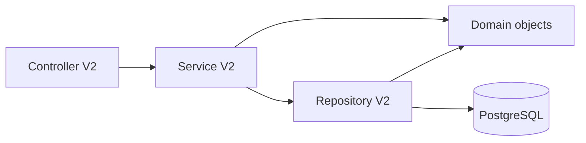

# Thiết kế class, cơ sở dữ liệu và API V2

**Phạm vi:** mô hình class, ranh giới lưu trữ PostgreSQL và hợp đồng API cho Employee, Attendance, Request V2. Đây là thiết kế đích dựa trên mã hiện có; tài liệu phân biệt phần đang có với phần đề xuất, không khẳng định đề xuất đã được triển khai.

## 1. Luồng xử lý



- **Controller** nhận HTTP, lấy actor từ `ApiContext`, chuyển dữ liệu thành command và trả DTO. `employeeId` là nhân viên chịu tác động, không phải danh tính actor.
- **Service** điều phối domain và repository; domain không truy vấn SQL.
- **Repository** là nơi duy nhất hydrate/persist employee. `EmployeeV2Repository.fromRow/toRow` là mapper chuẩn; `EmployeeV2Service.rowToEmployee/save` hiện vẫn chứa mapper và SQL trùng lặp nên thiết kế đích chuyển toàn bộ phần đó sang repository.
- `PersonName`, `Position`, `Shift`, `Leave`, `WorkMetrics`, `GeoLocation` là value objects; map thuộc tính của chúng vào các cột bảng cha, không tạo một bảng cho mỗi class.
- Các lần ghi ảnh hưởng nhiều bảng dùng một transaction để kết quả không bị lưu nửa chừng.

## 2. Các class domain V2

### Employee

| Class | Thuộc tính `{tên: kiểu — ý nghĩa; lưu ở đâu}` | Phương thức chính |
|---|---|---|
| `Employee` | `profile: EmployeeProfile`, `account: EmployeeAccount`, `contract: EmployeeContract` — aggregate, không lưu JSON; `version: number` — phiên bản aggregate, map `staff.aggregate_rev`; `uuid: string`, `username: string`, `fullName: string` — getter từ object con. | Hiện có `updateProfile(patch: EmployeeProfilePatch): Employee`, `updateAccount(patch: EmployeeAccountPatch): Employee`, `updateContract(patch: Partial<EmployeeContractParams>): Employee`, `changePosition(patch: { type?: string; level?: number; jobTitle?: string|null }): Employee`, `changeShift(patch: { type?: ShiftType; startTime?: string; endTime?: string; allowancePct?: number }): Employee`, `updateLeave(patch: { totalDays?: number; usedDays?: number }): Employee`, `toDTO(): EmployeeDTO`. Các update trả aggregate mới; `version` giữ nguyên đến khi repository trả entity đã lưu với phiên bản mới. |
| `EmployeeProfile` | `uuid: string → staff.uuid`; `name: PersonNameLike → staff.name/family_name/given_name`; `birthday: string|null → staff.birthday`; `dependants: number → staff.dependants`. Getter `familyName/givenName/fullName` lấy từ name; fullName derived. | `update(EmployeeProfilePatch)`, `toJSON()`. |
| `PersonName` | `familyName: string → staff.family_name`; `givenName: string → staff.given_name`; `fullName: string → staff.name` (legacy/fallback và JSON derived từ parts khi có). | `fromFullName`, `fromParts`, `withChanges`, `toJSON`. |
| `EmployeeAccount` | Hiện `username: string → staff.username`; `passwordHash: string → staff.pass_hash`; `roles: readonly string[] → staff.role + staff_roles`; `isLocked: boolean → derived từ locked_at/isLocked`; `lockedAt/lockedBy: string|null → staff.locked_at/locked_by`; `createdAt: string → staff.created_at`. Target class/JSON dùng `primaryRole: string + grantedRoles: readonly string[]`. `passwordHash` không ra DTO/JSON. | `hasRole(role: string): boolean`, `lock(by: string, at?: string): EmployeeAccount`, `unlock(): EmployeeAccount`, `update(patch: EmployeeAccountPatch): EmployeeAccount`, `toJSON(): EmployeeAccountDTO`. |
| `EmployeeContract` | `position: PositionLike`, `shift: ShiftLike`, `leave: LeaveLike` — object phẳng ở `staff`; `status: ContractStatus → canonical status target`; `effectiveFrom/endDate/resignedOn: string|null → start_date/contract/resigned_on`; `hasInsurance/isUnionMember/hasTax/canAdvance/isDormResident: boolean → insured/deduct_on/tax_on/advance_on/idorm`. Status domain: `tts|ctv|thuviec|nv|nghiviec`. | `update`, `changePosition`, `changeShift`, `updateLeave`, `toJSON`. |
| `Position` | `type: string → staff.type`; `level: number → staff.level`; `jobTitle: string|null → staff.job_title`. `type` là phân loại chức vụ, không phải tình trạng hợp đồng. | `withChanges`, `toJSON`. |
| `Shift` | `type: ShiftType → staff.shift_type`; `startTime/endTime: string HH:mm → staff.shift_start_time/shift_end_time`; `allowancePct: number → staff.shift_allowance_pct`; `isOvernight(): boolean` derived. | `isOvernight`, `withChanges`, `toJSON`. |
| `Leave` | `totalDays/usedDays: number → staff.leave_total_days/leave_used_days`; `remainingDays(): number` derived từ hai giá trị, tương thích có thể chiếu vào `staff.leave_balance`. | `remainingDays`, `canTakeLeave`, `useLeave`, `withChanges`, `toJSON`. |

**Ranh giới role/status đề xuất:** nội bộ `EmployeeAccount` có `primaryRole: string` và `grantedRoles: readonly string[]`; DTO công khai có thể trả `primaryRole` cùng `roles` tổng hợp. `staff.role` là `primaryRole`; vai trò phụ nằm trong `staff_roles`. Không dùng phần tử đầu của một mảng role mơ hồ làm nguồn cho cả hai loại. Dùng một cột canonical nhỏ `staff.employment_status` cho năm status domain; giữ `contract_status` làm projection tương thích trong lúc caller cũ còn dùng. `staff.type` chỉ ánh xạ `Position.type`. `remainingDays` và `fullName` không là nguồn lưu trữ độc lập.

### Attendance

| Class | Thuộc tính `{tên: kiểu — ý nghĩa; lưu ở đâu}` | Phương thức chính |
|---|---|---|
| `PunchEvent` | `id: UUID → punch_events.id`; `employeeId: UUID string → employee_id`; `punchedAt: Date → punched_at TIMESTAMPTZ`; `workDate: string → work_date DATE`; `type: IN|OUT → type`; `userLocation: GeoLocation`; `distanceMeters: number → distance_meters`; `isWithinOffice: boolean → is_within_office`; `note: string|null → note`. | `create(props: CreatePunchEventProps): PunchEvent`, `isValid(): boolean`, `toRow(): PunchEventRow`, `fromRow(row: PunchEventRow): PunchEvent`, `toJSON(): PunchEventDTO`. |
| `GeoLocation` | `latitude/longitude/accuracyMeters: number` — tọa độ quan sát trong `punch_events.latitude/longitude/accuracy_meters`. | `calculateDistanceMeters`, `isWithinRadius`, `equals`, `toJSON`. |
| `DailyTimesheet` | `id/employeeId: string UUID → id/employee_id`; `workDate: string DATE → work_date`; `shiftType: ShiftType → shift_type`; `shiftStartTime/shiftEndTime: string HH:mm → shift_start_time/shift_end_time`; `shiftAllowancePct: number → shift_allowance_pct`; `actualCheckIn/actualCheckOut: Date|null → actual_check_in/actual_check_out TIMESTAMPTZ`; `metrics: WorkMetrics`; `status: DailyTimesheetStatus → status`; `isLocked: boolean → is_locked`; target thêm `version: number → rev`. | `create(props: CreateDailyTimesheetProps): DailyTimesheet`; hiện có `calculate(punches: PunchEvent[], options?: CalculateOptions): DailyTimesheet`, `applyApprovedLeave(isPaid: boolean): DailyTimesheet`, `lockForPayroll(): DailyTimesheet`, `toRow(): DailyTimesheetRow`, `fromRow(row): DailyTimesheet`, `toJSON(): DailyTimesheetDTO`. |
| `WorkMetrics` | `workHours: number → work_hours`; `workUnits: number → work_units`; `otHours: number → ot_hours`; `lateMinutes: number → late_minutes`; `earlyMinutes: number → early_minutes`. Các cột là projection trên `timesheet_entries`, không có bảng riêng. | `zero`, `empty`, `withChanges`, `equals`, `toJSON`. |

Thuộc tính `DailyTimesheet` được persist tách thành cột trong cùng hàng `timesheet_entries`; `metrics` là object trong domain/DTO nhưng năm field của nó là năm cột DB ở trên.

**Session đề xuất:** thêm một class `PunchSession` và một bảng `attendance_v2_sessions` để ghép IN/OUT rõ ràng. Class có `id: UUID`, `employeeId: UUID`, `workDate: DATE`, `checkInPunchId: UUID`, `checkOutPunchId: UUID|null`, `version: number`. `PunchEvent` nhận thêm `sessionId: UUID|null` (NULL cho dữ liệu lịch sử chưa gắn session; ghi mới có session). Một session có một punch IN và tối đa một punch OUT; OUT null nghĩa là ca còn mở. Hai FK session↔punch cần `DEFERRABLE INITIALLY DEFERRED`, để service tạo trước UUID cho cả hai, insert hai phía trong cùng transaction và kiểm tra đầy đủ tại commit. `PunchSession.effectiveInterval(punches: PunchEvent[], approvedCorrections: SystemRequest[]): { checkIn: Date|null; checkOut: Date|null }` là phương thức domain đề xuất; Service/Repository tải dữ liệu, domain chỉ tính effective interval. Lưu punch raw như hiện tại, không ghi đè event khi điều chỉnh.

### Request

`SystemRequest` là một class cho bốn biến thể, giữ chung parent row hiện tại:

| Nhóm thuộc tính | Thuộc tính domain | Ý nghĩa |
|---|---|---|
| Chung | `id: string`, `employeeId: string`, `title/reason: string`, `type: RequestType`, `status: RequestStatus`, `reviewedBy/reviewNote: string|null`, `reviewedAt/createdAt/updatedAt: Date` (reviewedAt nullable) → cột chung `system_requests`; target `version: number → rev`. | `type` là `LEAVE|TIME_CORRECTION|OVERTIME|ADVANCE`; `status` là `PENDING|APPROVED|REJECTED|CANCELLED`. |
| Nghỉ | `leaveType: LeaveType|null`, `leaveStartDate/leaveEndDate: string|null`, `leaveDaysCount: number|null` → `leave_type`, `leave_start_date`, `leave_end_date`, `leave_days_count`. | `leaveType` là `PAID|UNPAID`; ngày là date-only. |
| Sửa công | `correctionDate: string|null`, `correctionPunchType: IN|OUT|null`, `correctionActualTime: string|null` → `correction_date`, `correction_punch_type`, `correction_actual_time`. | Target đích thêm `correctionSessionId: UUID|null` (cột `correction_session_id`, FK tới session) để tham chiếu session đã có. Metadata request là lịch sử; effective interval được tính từ raw punch và request correction đã duyệt, không tạo raw event giả hay ghi đè raw punch. |
| OT | `otDate: string|null`, `otStartTime/otEndTime: string|null`, `otHours: number|null` → các cột `ot_*`. | Ngày date-only, giờ local `HH:mm`, số giờ numeric. |
| Tạm ứng | `advanceAmount: bigint|number|null`, `advancePeriod: string|null` → `advance_amount BIGINT`, `advance_period`. | API JSON đích dùng decimal string để tránh mất chính xác số nguyên lớn; adapter đổi sang numeric khi lưu `BIGINT`. |

`SystemRequest` hiện có `createLeaveRequest(params: CreateLeaveParams): SystemRequest`, `createCorrectionRequest(params: CreateCorrectionParams): SystemRequest`, `createOvertimeRequest(params: CreateOvertimeParams): SystemRequest`, `createAdvanceRequest(params: CreateAdvanceParams): SystemRequest`, `approve(reviewerId: string, note?: string): SystemRequest`, `reject(reviewerId: string, note?: string): SystemRequest`, `cancel(cancellerId: string, reason?: string): SystemRequest`, `toRow(): SystemRequestRow`, `fromRow(row): SystemRequest`, `toJSON(): SystemRequestDTO`. Các payload hiện đang là các field nullable trên cùng class/row; thiết kế giữ union này trong bảng `system_requests`, thay vì tạo bốn bảng request mới. Dùng CHECK theo `type` để ràng buộc nhóm field tương ứng. Target thêm `version: number` vào class và DTO.

## 3. Mô hình PostgreSQL

### Bảng hiện có và quan hệ

| Bảng | Khóa/cột liên quan | Quan hệ và ý nghĩa |
|---|---|---|
| `staff` | PK `username TEXT`; `uuid TEXT UNIQUE`; account: `role`, `pass_hash`, `locked_at`, `locked_by`, `created_at`, `session_version`; profile: `name`, `family_name`, `given_name`, `birthday`, `dependants`; contract: `type`, `level`, `job_title`, `contract_status`, `start_date`, `contract`, `resigned_on`, `insured`, `deduct_on`, `tax_on`, `advance_on`, `idorm`, `payroll_subject`; ca: `shift_type`, `shift_start_time`, `shift_end_time`, `shift_allowance_pct`; phép: `leave_total_days`, `leave_used_days`, `leave_balance`, `leave_balance_on`. | Một hàng cho mỗi tài khoản/nhân viên. `uuid` hiện là TEXT, được các bảng dưới đây tham chiếu. Các value object Employee được flatten vào các nhóm cột này; không persist JSON aggregate. Target thêm `aggregate_rev BIGINT NOT NULL DEFAULT 1` cho `Employee.version`. |
| `staff_roles` | PK `id BIGINT`; `username`, `role`, `granted_by`, `granted_at`, `revoked_at`. | Nhiều role phụ theo username. Baseline có unique partial `(username, role)` cho dòng chưa thu hồi; hiện không khai báo FK `username → staff`. Mô hình đích tách rõ role chính ở `staff.role`, role phụ ở đây. |
| `punch_events` | PK `id UUID`; `employee_id TEXT`, `punched_at TIMESTAMPTZ`, `work_date DATE`, `type`, tọa độ/độ chính xác/khoảng cách, `is_within_office`, `note`, `created_at`. | Nhiều event cho một `staff.uuid`; FK hiện có `employee_id → staff.uuid`. Đây là log punch thô, không phải timesheet tổng hợp. |
| `timesheet_entries` | PK `id UUID`; `employee_id`, `work_date`, snapshot ca, check-in/out, metric columns, `status`, `is_locked`. | Mỗi nhân viên/ngày tối đa một dòng qua unique `(employee_id, work_date)`; FK `employee_id → staff.uuid`. Đây là snapshot/công ngày. Target thêm `rev BIGINT NOT NULL DEFAULT 1` cho `DailyTimesheet.version`. |
| `system_requests` | PK `id UUID`; `employee_id`, trường chung, các nhóm nullable `leave_*`, `correction_*`, `ot_*`, `advance_*`. | Một bảng parent cho bốn loại; FK `employee_id → staff.uuid`, `reviewed_by → staff.uuid`. Các nhóm payload hiện chưa được tách bảng. Target thêm `rev BIGINT NOT NULL DEFAULT 1` cho `SystemRequest.version`. |

### Ánh xạ thuộc tính và cấu trúc đích

| Domain | Bảng/cột hiện tại | Đích cấu trúc |
|---|---|---|
| `EmployeeProfile` | `staff.uuid`, `name`, `family_name`, `given_name`, `birthday`, `dependants` | Giữ cột phẳng; `name` là fallback/legacy full name, `fullName` domain được ghép từ các phần tên. |
| `EmployeeAccount` | `staff.username`, `pass_hash`, `role`, `locked_at/by`, `created_at`; role extras ở `staff_roles` | Giữ credential ngoài DTO. Map primary/granted roles thành hai field riêng trong domain; không để mapper đặt primary role phụ thuộc thứ tự query. |
| `EmployeeContract` | Các cột hợp đồng/benefit/shift/leave nêu trên | Thêm `employment_status` làm canonical status; `contract_status` là projection legacy. `type` tiếp tục là position type. |
| `PunchSession` (đề xuất) | Chưa có bảng/session FK ở baseline | `attendance_v2_sessions(id, employee_id, work_date, check_in_punch_id, check_out_punch_id, version)`. Thêm `punch_events.session_id` FK nullable để giữ nguyên lịch sử; dữ liệu mới ghi session ID. `check_out_punch_id` NULL khi session đang mở. FK hai chiều trì hoãn tới commit để hỗ trợ tạo cả session và punch raw cùng transaction. |
| `DailyTimesheet` / `WorkMetrics` | `timesheet_entries` gồm shift snapshot, actual timestamps, work/OT/late/early columns, status và lock | Giữ các metric là projection trong cùng bảng; không lưu `metrics` thành JSON hay bảng riêng. |
| `SystemRequest` | `system_requests` gồm chung columns và các nhóm nullable theo loại | Giữ một parent table; thêm CHECK per type. Thêm `correction_session_id UUID NULL REFERENCES attendance_v2_sessions(id)` làm target sửa công rõ ràng. Application service áp correction vào session effective view, raw `punch_events` không bị sửa. |

`employment_status` là cột target được đề xuất để domain status đủ năm giá trị; `contract_status` hiện chỉ CHECK `probation|official|NULL`. API/domain phải đọc canonical status. Không dùng `staff.type` làm status vì nó giữ vai trò phân loại `Position`.

## 4. Hợp đồng Service và Repository

### Employee

| Thành phần | Hợp đồng đích | Trách nhiệm |
|---|---|---|
| `EmployeeV2Service` | Hiện `findByUsernameOrUuid(id): Promise<Employee|null>`, `list(filter): Promise<Employee[]>`, `save(employee, by?): Promise<Employee>`, `delete(username): Promise<boolean>`. Đích `save(employee, { expectedVersion?: number, actor }): Promise<Employee>`; create bỏ version, update yêu cầu `expectedVersion`. | Điều phối use case. Bỏ mapper/SQL riêng tại service. |
| `EmployeeV2Repository` | Hiện `findAll`, `findByUsername`, `findByUuid`, `findByUsernameOrUuid`; `save(employee, actor?)`; `deleteByUsername`. Đích `save(employee, { expectedVersion?: number, actor }): Promise<Employee>` tăng và trả version mới khi update. | Đọc/ghi `staff` + `staff_roles`, là nơi duy nhất có `fromRow/toRow`. |

**Hiện trạng:** `EmployeeV2Module` mới inject `EmployeeV2Service`; service đang có `rowToEmployee`, query `staff`, gọi role store và tự save/delete. `EmployeeV2Repository` đồng thời đã có `static fromRow/toRow` và các method read/save/delete. Thiết kế đích đăng ký repository qua module và chuyển mapping/persistence sang một nơi.

### Attendance

| Thành phần | Hợp đồng hiện có/đích |
|---|---|
| `AttendanceV2Service` | Hiện có `recordPunch(input): Promise<RecordPunchResult>`, `getPunches(employeeId, workDate)`, `getTimesheet(employeeId, workDate)`, `listTimesheets(filter)`, `lockTimesheets(employeeId, startDate, endDate)`. Đích punch command mang `expectedVersion?: number` của timesheet đang có; response trả timesheet version mới. |
| `AttendanceV2Repository` | Hiện `savePunch`, `findPunches`, `saveTimesheet`, `findTimesheet`, `findTimesheetById`, `listTimesheets`, `lockTimesheets`. Đích `saveTimesheet(timesheet, expectedVersion): Promise<DailyTimesheet>` lưu projection/version và trả bản mới. Chịu trách nhiệm map `PunchEventRow`/`DailyTimesheetRow`. |
| `PunchSession` (đề xuất) | `open(employeeId: string, workDate: string, inPunchId: string): PunchSession`; `close(outPunchId: string): PunchSession`; `effectiveInterval(punches: PunchEvent[], approvedCorrections: SystemRequest[]): { checkIn: Date|null; checkOut: Date|null }`. Chỉ giữ cặp tham chiếu punch/version và tính effective interval từ dữ liệu đã nạp; không truy vấn SQL hay sở hữu raw event payload. |

### Request

| Thành phần | Hợp đồng hiện có |
|---|---|
| `RequestV2Service` | Hiện có `createLeaveRequest`, `createCorrectionRequest`, `createOvertimeRequest`, `createAdvanceRequest`, `reviewRequest(id, reviewerId, action, note)`, `cancelRequest(id, employeeId, reason)`, `getById`, `listRequests`. Đích `reviewRequest(id, expectedVersion, actor, action, note?)` và `cancelRequest(id, expectedVersion, actor, reason?)` trả DTO có version mới. |
| `RequestV2Repository` | Hiện `save(SystemRequest)`, `findById`, `list(filter)`, `count(filter)`. Đích `save(request, expectedVersion?): Promise<SystemRequest>`; create không truyền version, update truyền `expectedVersion` và trả bản đã lưu. Mapper qua `SystemRequest.toRow/fromRow`. |

Khi review: Controller lấy actor từ session/context; Service nhận `expectedVersion`, tải request, gọi `approve/reject`, rồi Repository lưu status/reviewer fields và version mới. Khi áp correction: Service tải target session có sẵn, request lưu `correction_session_id` làm tham chiếu lịch sử, còn `PunchSession.effectiveInterval` tính interval hiệu lực từ raw events và correction đã duyệt. Không tạo punch giả, không sửa raw punch, không thêm correction table riêng. Dùng cùng một transaction khi cập nhật request và bảng liên quan.

## 5. API V2

Các route dưới đây là route hiện có theo controller. `ApiContext` là nguồn actor; không đưa `actorId`, `reviewerId` hay `passwordHash` vào request body. `employeeId` chỉ là UUID của nhân viên chịu tác động; nếu thao tác thay mặt thì server phải kiểm tra quyền từ context.

| Method và path | Service method | Request hiện có / thiết kế payload | Response |
|---|---|---|---|
| `GET /api/v2/employees?shiftType=&status=&q=` | `list` | Query tùy chọn; hiện chưa có limit/offset. | `{ employees: EmployeeDTO[] }` |
| `GET /api/v2/employees/:username` | `findByUsernameOrUuid` | Segment hiện nhận username, service cũng tìm UUID. | `{ employee: EmployeeDTO }` |
| `POST /api/v2/employees` | `buildEmployeeFromInput`, `save` | Đích nhận `profile`, `account`, `contract` như ví dụ dưới. Password nhận plaintext khi tạo/reset; không nhận hash từ client. | `{ created: true, employee: EmployeeDTO }` với `employee.version = 1` |
| `PUT /api/v2/employees/:username` | `buildEmployeeFromInput`, `save` | Full aggregate input; `username` theo path; target update nhận `expectedVersion`. | `{ updated: true, employee: EmployeeDTO }` với `employee.version` mới |
| `PATCH /api/v2/employees/:username/profile` | `updateProfile`, `save` | Partial profile + `expectedVersion` bắt buộc ở target. | `{ updated: true, employee: EmployeeDTO }` với `employee.version` mới |
| `PATCH /api/v2/employees/:username/account` | `updateAccount`, `save` | Target nhận `password` plaintext, `primaryRole`, `grantedRoles`, `isLocked`; field `roles` cũ chỉ adapter tương thích nếu cần. `expectedVersion` bắt buộc; actor lock lấy từ context. | `{ updated: true, employee: EmployeeDTO }` với `employee.version` mới |
| `PATCH /api/v2/employees/:username/contract`, `/position`, `/shift`, `/leave` | `updateContract`, `changePosition`, `changeShift`, `updateLeave`, `save` | Partial fields theo object tương ứng + `expectedVersion` bắt buộc ở target. | `{ updated: true, employee: EmployeeDTO }` với `employee.version` mới |
| `DELETE /api/v2/employees/:username` | `delete` | Không có body. | `{ deleted: true, username }` |
| `POST /api/v2/attendance/punches` | `recordPunch` | `type`, tọa độ, note; hiện input còn cho `employeeId`, `workDate`, `punchedAt`, `shiftConfig`, `officeLocation`. Đích derive actor/giờ/ca/văn phòng từ context/config server; OUT nhận thêm `sessionId`; `expectedVersion` kiểm tra timesheet nếu đã có. | `{ sessionId, punch: PunchEventDTO, timesheet: DailyTimesheetDTO }`; timesheet trả version mới. |
| `GET /api/v2/attendance/punches?employeeId=&workDate=` | `getPunches` | Cần cả employeeId và workDate. | `{ punches: PunchEventDTO[] }` |
| `GET /api/v2/attendance/timesheets?employeeId=&startDate=&endDate=&status=` | `listTimesheets` | Query tùy chọn. | `{ timesheets: DailyTimesheetDTO[] }` |
| `GET /api/v2/attendance/timesheets/:employeeId/:workDate` | `getTimesheet` | UUID và date-only. | `{ timesheet: DailyTimesheetDTO }` |
| `POST /api/v2/requests/leave` | `createLeaveRequest` | `title`, `reason`, `leaveType`, `startDate`, `endDate`, `daysCount`; `employeeId` là subject tùy quyền/context. | `{ created: true, request: SystemRequestDTO }` |
| `POST /api/v2/requests/correction` | `createCorrectionRequest` | Hiện có `correctionDate/targetDate`, `punchType`, `actualTime` hoặc `correctedCheckIn/Out`; đích thêm `correctionSessionId` bắt buộc để xác định session. | `{ created: true, request: SystemRequestDTO }` |
| `POST /api/v2/requests/overtime` | `createOvertimeRequest` | `targetDate/otDate`, `startTime`, `endTime`, `hours/otHours`; service hiện có mặc định giờ nếu thiếu một phần. | `{ created: true, request: SystemRequestDTO }` |
| `POST /api/v2/requests/advance` | `createAdvanceRequest` | `title`, `reason`, `amount`, `period`; service hiện có default kỳ. Wire format đích cho amount là decimal string. | `{ created: true, request: SystemRequestDTO }` |
| `GET /api/v2/requests?employeeId=&type=&status=&limit=&offset=` | `listRequests` | Query filters; response có pagination result. | `{ items: SystemRequestDTO[], total: number }` |
| `GET /api/v2/requests/:id` | `getById` | UUID request. | `{ request: SystemRequestDTO }` |
| `PATCH /api/v2/requests/:id/review` | `reviewRequest` | `{ action: 'APPROVE'|'REJECT', note?, expectedVersion }`; target yêu cầu version, actor lấy context. | `{ updated: true, request: SystemRequestDTO }` với `request.version` mới |
| `PATCH /api/v2/requests/:id/cancel` | `cancelRequest` | `{ reason?, expectedVersion }`; target không nhận actor/employeeId từ body. | `{ updated: true, request: SystemRequestDTO }` với `request.version` mới |

### JSON minh họa payload đích

```json
{
  "profile": { "name": { "familyName": "Nguyen", "givenName": "An" }, "birthday": "1995-04-12", "dependants": 0 },
  "account": { "username": "an.nguyen", "password": "one-time-plaintext", "primaryRole": "staff", "grantedRoles": [] },
  "contract": {
    "status": "nv", "effectiveFrom": "2024-01-01", "position": { "type": "nv", "level": 1, "jobTitle": "Operator" },
    "shift": { "type": "NORMAL", "startTime": "08:00", "endTime": "17:00", "allowancePct": 0 },
    "leave": { "totalDays": 12, "usedDays": 2 }, "hasInsurance": true, "isUnionMember": false,
    "hasTax": true, "canAdvance": true, "isDormResident": false
  }
}
```

```json
{ "fullName": "Nguyen An", "birthday": "1995-04-12", "dependants": 1, "expectedVersion": 4 }
```

Body PATCH profile: `PATCH /api/v2/employees/an.nguyen/profile`.

```json
{ "primaryRole": "staff", "grantedRoles": ["scheduler"], "expectedVersion": 5 }
```

Body PATCH account: `PATCH /api/v2/employees/an.nguyen/account`. `roles` là adapter legacy nếu client cũ còn gửi field này.

```json
{ "type": "IN", "latitude": 10.78, "longitude": 106.69, "note": "Vào ca" }
```

```json
{ "type": "OUT", "sessionId": "a8098c65-886c-4a90-84e5-468f17bc025a", "latitude": 10.78, "longitude": 106.69 }
```

```json
{ "title": "Nghỉ phép", "reason": "Việc cá nhân", "leaveType": "PAID", "startDate": "2026-11-10", "endDate": "2026-11-11", "daysCount": 2 }
```

```json
{ "title": "Điều chỉnh giờ vào", "reason": "Điều chỉnh giờ vào của session đã có", "correctionDate": "2026-11-03", "correctionSessionId": "a8098c65-886c-4a90-84e5-468f17bc025a", "punchType": "IN", "actualTime": "08:04" }
```

```json
{ "title": "Làm thêm", "reason": "Bàn giao", "otDate": "2026-11-03", "startTime": "18:00", "endTime": "20:00", "hours": 2 }
```

```json
{ "title": "Tạm ứng", "reason": "Chi phí cá nhân", "amount": "5000000", "period": "2026-11" }
```

```json
{ "action": "APPROVE", "note": "Đã xem", "expectedVersion": 3 }
```

```json
{ "reason": "Đổi kế hoạch", "expectedVersion": 3 }
```

Body PATCH cancel: `PATCH /api/v2/requests/91ef009b-01a7-4826-a03a-507ee6d7dbf4/cancel`.

### Response minh họa

`POST /api/v2/employees`:

```json
{
  "created": true,
  "employee": {
    "profile": { "uuid": "a8098c65-886c-4a90-84e5-468f17bc025a", "familyName": "Nguyen", "givenName": "An", "fullName": "Nguyen An", "birthday": "1995-04-12", "dependants": 0 },
    "account": { "username": "an.nguyen", "primaryRole": "staff", "grantedRoles": [], "roles": ["staff"], "isLocked": false, "lockedAt": null, "lockedBy": null, "createdAt": "2026-11-03T08:00:00.000Z" },
    "contract": { "position": { "type": "nv", "level": 1, "jobTitle": "Operator" }, "shift": { "type": "NORMAL", "startTime": "08:00", "endTime": "17:00", "allowancePct": 0 }, "leave": { "totalDays": 12, "usedDays": 2, "remainingDays": 10 }, "status": "nv", "effectiveFrom": "2024-01-01", "endDate": null, "resignedOn": null, "hasInsurance": true, "isUnionMember": false, "hasTax": true, "canAdvance": true, "isDormResident": false },
    "version": 1
  }
}
```

`POST /api/v2/attendance/punches` target response:

```json
{
  "sessionId": "a8098c65-886c-4a90-84e5-468f17bc025a",
  "punch": { "id": "d2da61fb-31fd-462e-a1a9-a0d8c9ce8e51", "employeeId": "a8098c65-886c-4a90-84e5-468f17bc025a", "punchedAt": "2026-11-03T01:00:00.000Z", "workDate": "2026-11-03", "type": "IN", "userLocation": { "latitude": 10.78, "longitude": 106.69, "accuracyMeters": 0 }, "distanceMeters": 25, "isWithinOffice": true, "note": null },
  "timesheet": { "id": "d2da61fb-31fd-462e-a1a9-a0d8c9ce8e52", "employeeId": "a8098c65-886c-4a90-84e5-468f17bc025a", "workDate": "2026-11-03", "shiftType": "NORMAL", "shiftStartTime": "08:00", "shiftEndTime": "17:00", "shiftAllowancePct": 0, "actualCheckIn": "2026-11-03T01:00:00.000Z", "actualCheckOut": null, "metrics": { "workHours": 0, "workUnits": 0, "otHours": 0, "lateMinutes": 0, "earlyMinutes": 0 }, "status": "ABSENT", "isLocked": false, "version": 1 }
}
```

`passwordHash` không xuất hiện trong employee response.

### DTO và kiểu ngày/giờ

- Target `EmployeeDTO = { profile, account, contract, version: number }`; `account` chỉ có username, `primaryRole`, `grantedRoles`, roles dẫn xuất, lock metadata và createdAt, tuyệt đối không có passwordHash.
- `PunchEventDTO` chứa UUID employeeId, instant `punchedAt` dạng ISO string, `workDate` dạng `YYYY-MM-DD`, type, tọa độ và note. `DailyTimesheetDTO` chứa date-only, snapshot ca, ISO instants check-in/out, metrics, status, lock bit và target `version: number`.
- `SystemRequestDTO` trả common fields, các nhóm union fields nullable và target `version: number`; `reviewedAt/createdAt/updatedAt` là ISO instants, ngày request là date-only, giờ OT/correction là `HH:mm`. `advanceAmount` hiện được khai báo `number|string|null`; thiết kế wire string giữ chính xác giá trị BIGINT.
- Actor/reviewer identity không phải field của DTO ghi; API adapter lấy từ session/context. `employeeId` trên thao tác thay mặt chỉ xác định subject và cần server-side permission check.

## Căn cứ mã nguồn đã đối chiếu

- Domain Employee: `src/domain/employee-v2/employee.ts`, `employee-profile.ts`, `employee-account.ts`, `employee-contract.ts`, `person-name.ts`, `position.ts`, `shift.ts`, `leave.ts`, `types.ts`.
- Domain Attendance: `src/domain/attendance-v2/punch-event.ts`, `daily-timesheet.ts`, `work-metrics.ts`, `geo-location.ts`.
- Domain Request: `src/domain/request-v2/system-request.ts`, `types.ts`.
- Wiring/controller/service và route evidence: `src/modules/employee-v2/employee-v2.controller.ts:18-263`; `src/modules/attendance-v2/attendance-v2.controller.ts:10-75`; `src/modules/request-v2/request-v2.controller.ts:12-137`; các service tương ứng trong cùng thư mục module.
- Repository: `src/data/employee-v2.repository.ts`, `attendance-v2.repository.ts`, `request-v2.repository.ts`.
- Core schema: `migrations/postgres/0001_baseline.sql:185-200,203-207,221-280`.

