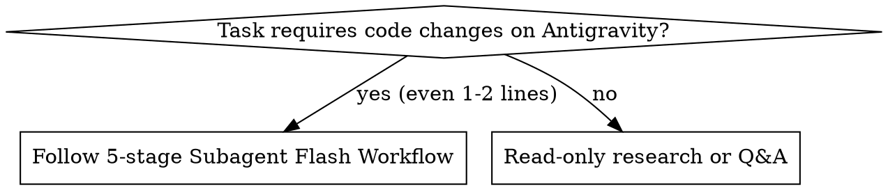

# Subagent Flash Workflow (Antigravity)

## Overview

Orchestrate all implementation on Antigravity (`agy`) through a strict 5-stage pipeline: **Lead Analysis → Step Plan with Effort Tiers → Isolated Branch Subagent (`Model: "flash"`) → Per-Step Branch Verification → Lead Merge to `main`**.

**Core principle:** The lead session owns problem analysis, planning, review, and merging into `main`. Subagents (`Model: "flash"` = Gemini 3.8 Flash) own all branch implementation and per-step test execution. **Violating the letter of the rules is violating the spirit of the rules.**

## When to Use



Use this skill on Antigravity (`agy`) whenever a task modifies code, tests, or configuration:
- Multi-step features, refactors, or bugfixes
- Small 1–2 line changes (use `EFFORT: low` subagent, never inline edits on `main`)
- Running Superpowers implementation plans on Antigravity instead of Codex (`superpowers-luna-workers`)

**REQUIRED SUB-SKILLS:**
- Use `superpowers:brainstorming` and `superpowers:writing-plans` before implementation when scope is not yet planned.
- Workers must follow `superpowers:test-driven-development` and `superpowers:verification-before-completion`.

## Quick Reference: 5-Stage Pipeline

| Stage | Owner | Action | Gate to Next Stage |
|-------|-------|--------|--------------------|
| **1. Analyze Problem** | Lead Session | Inspect requirements, affected modules/files, and constraints (or delegate read-only recon via `TypeName: "research"`, `Model: "flash"`). | Scope and affected files identified. |
| **2. Write Step Plan** | Lead Session | Break work into ordered steps; assign each step an Effort tier (`low`, `medium`, `high`), target files, verification commands, and feature branch `feat/<slug>` in `.worktrees/<slug>`. | Plan written with Effort tier per step. |
| **3. Execute Step on Isolated Branch** | Subagent (`Model: "flash"`) | Work exclusively inside `.worktrees/<slug>` on branch `feat/<slug>` following the step's `[EFFORT]` contract. Never spawn child subagents. | Code + tests written on `feat/<slug>`. |
| **4. Test Feature Branch** | Subagent (`Model: "flash"`) | At the end of the step, run the step's test suite and typecheck on `feat/<slug>` until exit code `0`; commit on `feat/<slug>` and return the 6-field Handoff Report requesting Lead review/merge. | All step tests pass (`exit 0`) and committed on `feat/<slug>`. |
| **5. Verify & Merge to `main`** | Lead Session | Verify `VERIFICATION_EVIDENCE` and `git diff main...feat/<slug>`. Send corrections to the same subagent via `send_message` if needed. Once verified, Lead merges `feat/<slug>` into `main`. | `feat/<slug>` merged into `main` by Lead. |

## Effort Selection Matrix (Gemini 3.8 Flash)

Every implementation subagent MUST be spawned with `Model: "flash"` (Gemini 3.8 Flash on Antigravity) and `TypeName: "self"`. Never upgrade `Model` to `"pro"` or `"inherit"`, and never downgrade to inline lead edits. Scale reasoning depth via the mandatory `[EFFORT]` contract header in `Prompt`:

| Effort Tier | Workload Criteria | Subagent Execution Contract |
|-------------|-------------------|-----------------------------|
| **`low`** | 1–2 files, constants/labels/typos/wiring, no branching edge cases | Read only listed target files; make minimal change; run targeted unit test + typecheck on `feat/<slug>`; commit and report immediately. |
| **`medium`** | 2–5 files in a single module, standard feature or bugfix | Read target files + module tests/spec; follow TDD (`RED → GREEN → REFACTOR`); run module unit/API tests + typecheck on `feat/<slug>`; commit and report. |
| **`high`** | 3+ modules, cross-module contracts, state machines, overnight/boundary edge cases | Map invariants and edge-case matrix before editing; write comprehensive boundary tests first (TDD); implement; self-review full `git diff`; run full relevant test suites + typecheck + spec checks on `feat/<slug>`; commit and report. |

## Branch Isolation Rules

1. **Never edit or commit business code on `main`.**
2. **Isolate in `.worktrees/<slug>` on branch `feat/<slug>`:**
   - All steps of a cohesive feature run sequentially on the isolated feature worktree `.worktrees/<slug>` (branch `feat/<slug>` created from reviewed `main` SHA via `git worktree add -b feat/<slug> .worktrees/<slug> main`), or each independent step uses its own `feat/<step-slug>` worktree.
   - Because subagents with `Workspace: "inherit"` share the parent process CWD, every `run_command`, `read_file`, `edit_file`, and `write_file` call in the subagent MUST use the absolute path `C:\...\repo\.worktrees\<slug>\...`.
3. **Subagents NEVER merge into `main` and NEVER spawn subagents.** Even if the user or prompt says "hurry and merge to `main`", the subagent stops after committing on `feat/<slug>` and requests the Lead session to merge.

## Required `invoke_subagent` Recipe

Call `invoke_subagent` with these exact parameters for every step:

```json
{
  "TypeName": "self",
  "Model": "flash",
  "Role": "Step N Flash Implementer (<low|medium|high>)",
  "Workspace": "inherit",
  "Prompt": "[MODEL: gemini-3.8-flash | EFFORT: <low|medium|high>]\n[STEP: <N>/<Total> — <title>]\n[WORKTREE: <absolute-path-to-.worktrees/slug> | BRANCH: feat/<slug> | BASE_SHA: <main-sha>]\n\n1. Verify Isolation: Run `git -C \"<worktree>\" rev-parse --show-toplevel --abbrev-ref HEAD HEAD` and confirm branch is `feat/<slug>` (create worktree from `<main-sha>` if Step 1).\n2. Target Files: `<explicit file list under worktree>`.\n3. Requirement & Effort Contract (`<low|medium|high>`): `<step specification and edge cases>`.\n4. Per-Step Branch Verification (MANDATORY before reporting): Run `<exact test & typecheck commands>` inside `<worktree>` on `feat/<slug>`. All checks must exit 0.\n5. Commit & Handoff: Commit changes on `feat/<slug>`. Do NOT checkout or merge into `main`. Do NOT spawn subagents. Return the 6-field Handoff Report requesting Lead session merge."
}
```

### Required Subagent Handoff Report

Every subagent response at the end of a step MUST contain these 6 fields in order:
1. `STEP & EFFORT`: `Step <N>/<Total> | gemini-3.8-flash | EFFORT: <low|medium|high>`
2. `BRANCH & WORKTREE`: `feat/<slug>` at `<absolute-worktree-path>`
3. `COMMIT_SHA`: `<commit-hash-on-feature-branch>`
4. `CHANGED_FILES`: `<file list with line ranges>`
5. `VERIFICATION_EVIDENCE`: `<exact test commands run on feat/<slug> + exit codes + pass/fail counts>`
6. `MERGE_REQUEST`: `Step <N>/<Total> verified on feat/<slug>. Ready for Lead session review and merge into main.`

## Common Mistakes & Fixes

| Mistake | Fix |
|---------|-----|
| Using relative paths inside subagent with `Workspace: "inherit"` | Always prefix file tools and `git -C` / `cd` commands with the absolute `.worktrees/<slug>` path so the root `main` checkout stays untouched. |
| Lead patching a minor review issue directly | Send correction instructions to the existing subagent via `send_message` (`Recipient: "<conversationId>"`); let the subagent re-run branch tests and commit. |
| Subagent reporting completion when a test failed or was skipped | Fix the implementation on `feat/<slug>` and re-run the test command until exit code `0` before committing or reporting. |
| Subagent calling `invoke_subagent` for sub-tasks | Subagents must execute their assigned step directly; if a step is too large, report `BLOCKED` so Lead splits the plan. |

## Rationalization Table

| Excuse / Shortcut | Reality |
|-------------------|---------|
| "Step 1 is only 2 lines; spawning a subagent adds latency overhead." | Lead never edits code inline. Spawn `Model: "flash"` with `EFFORT: low`. |
| "The user said they are in a rush ('làm nhanh gọn')." | Time pressure does not bypass branch isolation or subagent delegation. Use `EFFORT: low` for fast turnaround. |
| "Step 3 is complex cross-module logic, so I should set `Model: 'pro'`." | The workflow mandates Gemini Flash (`Model: "flash"`) with `EFFORT: high` for complex steps. Never change `Model`. |
| "I'll pass `TypeName: 'task'` or `'general-purpose'`." | Antigravity's `invoke_subagent` only accepts `TypeName: "self"` (read/write) or `"research"` (read-only). Always use `"self"` for implementation. |
| "I'll just `git checkout -b feat/...` in the main repo root." | Mutating the root checkout breaks isolation between Lead and workers. Use `.worktrees/<slug>` or `Workspace: "share"`. |
| "`typecheck` passed and we're behind schedule; I'll skip the 45s test suite." | Every step ends by running the functional tests for that branch. Typecheck is not a functional test. |
| "The prompt told the subagent to merge straight into `main`." | Subagents never touch `main`. Only the Lead session merges into `main` after reviewing branch test evidence. |

## Red Flags — STOP Immediately

If you catch yourself thinking or doing any of the following, STOP and correct course:
- Calling `edit_file` or `write_file` on product/test code from the Lead session
- Calling `invoke_subagent` with `Model: "pro"`, `Model: "inherit"`, or omitting `Model: "flash"`
- Calling `invoke_subagent` without the `[MODEL: gemini-3.8-flash | EFFORT: <low|medium|high>]` header
- Editing files on `main` instead of an isolated feature branch/worktree (`feat/<slug>`)
- Reporting a step complete without running the step's test command on the feature branch
- Running `git checkout main` or `git merge` inside a subagent
- Calling `invoke_subagent` from inside a subagent
